**Software Engineer II** at MyComplianceOffice · Hyderabad, India

 

## I make slow software fast and fragile software solid.

Four years at HighRadius, where I went from intern to SDE-II across five roles. Now I build mission-critical compliance products at MyComplianceOffice, owning both the Java APIs and the Angular UI.

On the side, I train and red-team AI coding models (RLHF) for Surge AI and DataAnnotation.tech, which means I get paid to find the bugs in code that AI writes.

 

<picture>
  <source media="(prefers-color-scheme: dark)" srcset="assets/impact-dark.svg" />
  
</picture>

 

## What I'm known for

- **Breaking up monoliths.** I co-architected a micro-frontend framework on Webpack Module Federation that stitched several Order-to-Cash apps into one product and cut load times by 60%.
- **Building from zero.** I helped design and build a greenfield Payments module that cut setup cycles by 80%.
- **Making the invisible visible.** I rolled Sentry APM into legacy SaaS apps, so bugs show up with context instead of guesswork. Debugging got 50%+ faster.
- **Locking things down.** SSO for central identity services, JUnit coverage and SonarQube and Checkmarx scans that hardened legacy codebases.

## My toolkit

  

## Things I've shipped

<table>
  <tr>
    <td width="50%" valign="top">
      <h3><a href="https://github.com/agarwalU001/TrackSlide">TrackSlide</a></h3>
      
Turns the edges of a Windows touchpad into volume and brightness sliders, and its corners into shortcuts. It reads raw finger data from the touchpad driver, rejects palms and adds a tick sound because laptops have no haptics.

      
      
      
    </td>
    <td width="50%" valign="top">
      <h3>JEE Simplified</h3>
      
An e-learning platform for engineering entrance exam prep, built from zero to launch as a freelance contract: video streaming on demand, secure checkout and automated payment notifications.

      
      
      
    </td>
  </tr>
</table>

**Open source:** merged fixes in [bunori](https://github.com/bunoriapp/bunori) (Android light-novel reader) and [agent-security](https://github.com/solongate/agent-security) (a security gateway for AI coding agents).

## Recognition

- 🏆 **"You Earned It" Award**, MyComplianceOffice: for technical execution and milestone ownership
- 🚀 **HighFlyer Spot Award**, HighRadius, H2 2024: for outstanding software delivery
- ⭐ **HighFlyer Fresher of the Year**, HighRadius, 2023: for exceptional ramp-up and engineering execution

 

### Need something built fast and built right?

I'm open to freelance work and new roles.

